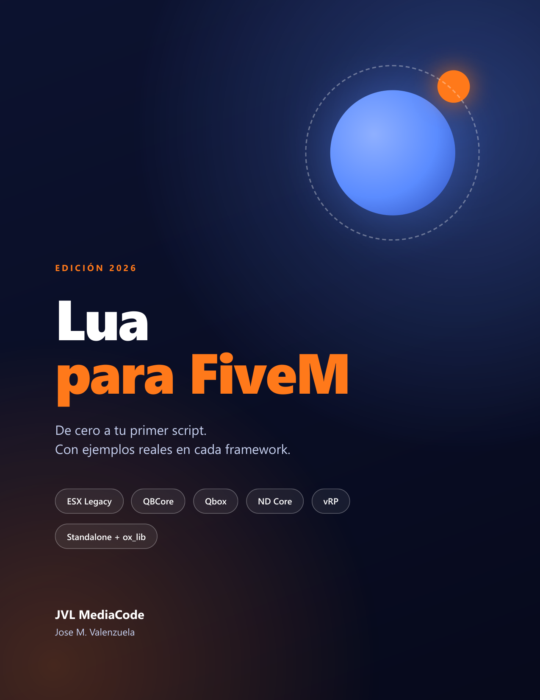

# Lua para FiveM · Muestra gratis

**De cero a tu primer script, con ejemplos reales en cada framework.**
Edición 2026 · 28 capítulos · 134 páginas · en español

## Descarga la muestra

📄 **[Lua-para-FiveM-muestra.pdf](Lua-para-FiveM-muestra.pdf)**: la bienvenida, el índice completo y dos capítulos:

- **1. Lua en FiveM**: dónde corre tu código y cómo se organiza un resource.
- **17. Seguridad**: cómo validar eventos en el servidor para que no te roben dinero ni items.

## Qué trae el libro completo

| Parte | Qué aprendes |
| --- | --- |
| **1. Lua esencial** | El lenguaje, explicado con ejemplos de FiveM desde la primera línea. |
| **2. FiveM por dentro** | Resources, cliente y servidor, eventos, hilos, natives, oxmysql, NUI, seguridad y rendimiento. |
| **3. Frameworks** | ESX Legacy, QBCore, Qbox, ND Core, vRP y standalone con ox_lib, con la **misma tarea** resuelta en cada uno, y un puente multi-framework. |
| **4. Proyecto final** | Un trabajo de repartidor completo, probado en un servidor real. |

APIs revisadas contra la documentación oficial de octubre de 2026.

El código del proyecto final es gratis: [jvalenzmedia/jvl_reparto](https://github.com/jvalenzmedia/jvl_reparto).

## Consigue el libro

🛒 **[Cómpralo en Zeltrade](https://www.zeltrade.shop/catalog/producto.php?slug=lua-para-fivem-de-cero-a-tu-primer-script-edici-on-2026)**: PDF a color de 134 páginas, en español.

---

© 2026 JVL MediaCode · Jose M. Valenzuela · [jvlmediacode.com](https://jvlmediacode.com) · [Discord](https://discord.gg/m2spgxkPfj)
La muestra se puede compartir libremente sin modificarla. El libro completo es de uso personal.
